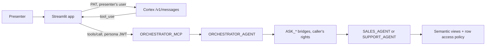
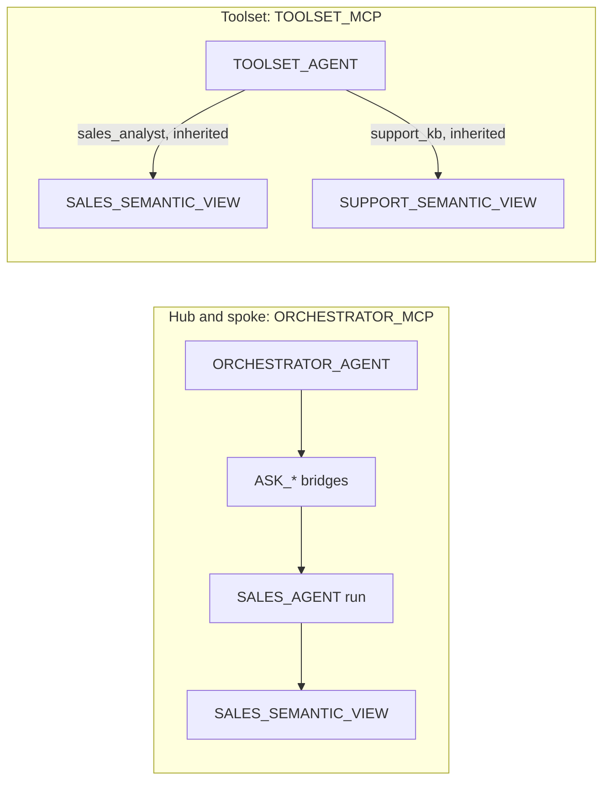

# Multi-Agent Orchestration over MCP: One Governed Front Door for Any AI Client

[View Presentation](https://sfc-gh-snuggehalli.github.io/field-demo-enablement/multi-agent-mcp/presentations/multi-agent-mcp.html)

An external AI assistant reaches governed company data through a **Snowflake-managed MCP server**.
The Streamlit app in `app/` plays the part of Claude Desktop with a Snowflake connector:

- **A Claude model** (`claude-sonnet-4-6` on Cortex's Anthropic-compatible `/api/v2/cortex/v1/messages`) sees the server's tools exactly as `tools/list` describes them, and decides when to call one.
- **The app** sends each tool call as a JSON-RPC `tools/call` to `MULTI_AGENT_MCP_DEMO.APP.ORCHESTRATOR_MCP`, signed in as the selected persona.

On the Snowflake side this is the same traffic Claude, ChatGPT or Cursor would send, and the server cannot tell them apart. The only differences are on the client side: who hosts the model, and how the person signs in (here key-pair JWT; in Claude, OAuth).



**Two identities, as with Claude.** The model call uses a PAT on the presenter's user. It plays the LLM vendor's part and never reads governed data. The tool call uses the persona user's key pair. That is the identity the MCP server, the orchestrator, the caller's-rights bridges and the row access policy see, through its `DEFAULT_ROLE`.

## Audience

SEs, architects & AI platform teams deciding how AI clients (Claude, ChatGPT, Cursor, in-house assistants) should reach governed Snowflake data, and how to split a multi-domain assistant into agents.

## Topics Covered

- Snowflake-managed MCP servers with a single `CORTEX_AGENT_RUN` tool
- Hub-and-spoke orchestration: an orchestrator agent delegating to specialist agents through caller's-rights `DATA_AGENT_RUN` bridges
- A persona boundary built from four layers of grants (agent USAGE, semantic view and table SELECT, a fail-closed row access policy), not prompts
- Two identities in an MCP client: a PAT for the model call, a persona key-pair JWT for the tool call
- Agent toolsets (`agent_toolset`) as the alternative to hub and spoke, and their silent-skip behavior
- Cortex Agent evaluations (`answer_correctness`, `logical_consistency`, `tool_selection_accuracy`) comparing both architectures

## Contents

| File | Description |
|------|-------------|
| `presentations/multi-agent-mcp.html` | Slide deck (12 slides) |
| `presentations/multi-agent-mcp-speaker-notes.md` | Per-slide speaker notes with talking points, presenter notes, and references |
| `demo_script.md` | Live run-of-show (about 20 minutes): deck and app beats, fill-talk, cuts, recovery tips, Q&A prep |
| `demo.sh` | One script for setup, the headless build, the notebook, the app, the smoke test, PAT reissue and teardown |
| `pyproject.toml`, `uv.lock` | Local Python environment (notebook, app, smoke test, Snowflake CLI), managed by uv |
| `lab/setup.sql` | The governed stack: database, warehouse, roles, persona users, data, semantic views, row access policy, bridges, agents, grants |
| `lab/multi-agent-mcp-lab.ipynb` | The lab notebook: both MCP servers, the toolset agent, the persona boundary over MCP, evaluations; a CHECK per section |
| `lab/cleanup.sql` | Tear everything down to start fresh |
| `app/streamlit_app.py`, `app/host_llm.py`, `app/snowflake_mcp.py`, `app/personas.py` | The Claude-style MCP client: key-pair JWT signing, JSON-RPC MCP client (SSE `tools/call`), host model loop, UI with an inspector and side-by-side compares |
| `client/mcp_smoke.py` | Headless check: `tools/list` and `tools/call` as each persona, no model involved |
| `docs/toolsets-vs-hub-and-spoke.md` | Plain-language walkthrough of how agent toolsets differ from hub and spoke, with worked examples |

## Hands-On Lab

`./demo.sh setup` builds the governed stack and the credentials; the notebook builds what this demo
adds on top of it, and checks each step.

| Section | What it builds | CHECK |
|---|---|---|
| 0 | Connect, account guard | - |
| 1 | Nothing (inspects `setup.sql`'s stack) | three agents exist; grants split by domain; row access policy returns 44 / 16 / 0 rows for admin / EMEA seller / support |
| 2 | `ORCHESTRATOR_MCP` and its grants | one `CORTEX_AGENT_RUN` tool `northwind_assistant`; USAGE for each persona |
| 3 | `TOOLSET_AGENT`, `TOOLSET_MCP` and their grants | both exist, same tool name |
| 4 | Nothing (calls both servers as each persona over MCP, then the orchestrator over SQL `DATA_AGENT_RUN` as each persona) | one tool for everyone; global exec sees all theaters, EMEA seller sees EMEA only, support rep gets no sales numbers (hub: `NOT_ENTITLED`); same answers over SQL |
| 5 | Evaluation inputs, datasets, config stage; two evaluation runs | both runs complete with scores |
| 6 | The 15-minute click-path | - |

### Prerequisites

- A Snowflake demo account (Enterprise) with Cortex Agents and `claude-sonnet-4-6` available (directly or through cross-region inference).
- A user that can use **ACCOUNTADMIN**: `setup.sql` creates roles and service users, and `demo.sh` registers the persona public keys and the host-model PAT as ACCOUNTADMIN. Everything else runs as `MULTI_AGENT_MCP_DEMO_ADMIN`, which setup grants to you.
- A network the account's network policy allows. A PAT on a person user only authenticates under a network policy.
- [uv](https://docs.astral.sh/uv/) (`brew install uv`), `openssl`, and a Snowflake CLI connection (`snow connection add`, or any entry in `~/.snowflake/config.toml`) for the local quick start.

### Quick start

```bash
chmod +x demo.sh                                  # once, after cloning
./demo.sh setup -c <connection> --create-pat      # governed stack, persona keys, host-model PAT, .env
./demo.sh build --yes                             # run the notebook headless: every section, every CHECK
./demo.sh app                                     # the Claude-style client at http://localhost:8501
./demo.sh teardown --yes                          # drop everything, remove the PAT and the keys
```

`setup` and `build` are safe to re-run. `./demo.sh build --yes --skip-evals` skips the evaluations
(they take several minutes). `./demo.sh smoke` (or `smoke --server toolset`) checks `tools/list` and
`tools/call` as each persona without a model. The host-model PAT lasts 7 days: `./demo.sh pat`
reissues it, and `app` stops with that hint once it has expired.

### Set up with Cortex Code

Open this repository in Cortex Code and paste:

```text
Set up the Multi-Agent Orchestration over MCP lab in the multi-agent-mcp folder on my Snowflake demo account.
1. If uv is not installed, ask me before installing it (brew install uv). If demo.sh is not
   executable, run it as bash demo.sh.
2. Run ./demo.sh --help, then ./demo.sh setup. Add </dev/null to every demo.sh command
   so it never waits for typed input. When it stops and names a flag (such as
   -c <connection>), show me the options it printed (point out the connection marked
   is_default), ask me which to use, and re-run with that flag. When it asks about a PAT,
   tell me it creates a 7-day PAT on my user restricted to MULTI_AGENT_MCP_DEMO_ADMIN, and
   re-run with --create-pat only if I agree. If I have no Snowflake CLI connection, help me
   create one with snow connection add.
3. Judge progress by the lines starting with ==>, CHECK or ERROR: (SQL output goes to .logs/).
   If it seems stuck on sign-in, tell me to finish the browser sign-in, then re-run the
   same command.
4. When setup prints Done, ask me before running ./demo.sh build --yes (it creates two MCP
   servers and an agent, calls the agents as each persona and starts two evaluations).
   When it finishes, show me every CHECK line it printed.
5. Then tell me to run ./demo.sh app in my own terminal and open http://localhost:8501.
Do not run teardown or pat unless I ask.
```

### Manual setup

Run `lab/setup.sql` in Snowsight as a user that can use ACCOUNTADMIN. This creates:

- Database `MULTI_AGENT_MCP_DEMO` (schema `APP`) and warehouse `MULTI_AGENT_MCP_DEMO_WH` (X-Small, auto-suspend 60 s)
- Roles `MULTI_AGENT_MCP_DEMO_ADMIN` (owns the objects, granted to you) and three persona roles `..._SALES_GLOBAL`, `..._SALES_EMEA`, `..._SUPPORT`
- Service users `MULTI_AGENT_MCP_DEMO_{SALES_GLOBAL,SALES_EMEA,SUPPORT}_USER`, each with its persona role as `DEFAULT_ROLE`
- Tables `SALES_BOOKINGS` (44 rows), `SUPPORT_KB` (8 articles), `SALES_ENTITLEMENTS`; semantic views `SALES_SEMANTIC_VIEW`, `SUPPORT_SEMANTIC_VIEW`; row access policy `SALES_THEATER_POLICY`
- Bridge procedures `ASK_SALES_SPECIALIST`, `ASK_SUPPORT_SPECIALIST` (`EXECUTE AS CALLER`); agents `SALES_AGENT`, `SUPPORT_AGENT`, `ORCHESTRATOR_AGENT`; the persona grants

Then, by hand, what `demo.sh` would do: generate a key pair per persona and register it
(`ALTER USER MULTI_AGENT_MCP_DEMO_SALES_EMEA_USER SET RSA_PUBLIC_KEY = '...'`), create a PAT on
your user (`ALTER USER <you> ADD PROGRAMMATIC ACCESS TOKEN MULTI_AGENT_MCP_DEMO ROLE_RESTRICTION = 'MULTI_AGENT_MCP_DEMO_ADMIN' DAYS_TO_EXPIRY = 7`),
and write `.env` with the keys listed in `demo.sh`'s `write_env`.

### Lab Sections

1. **The governed stack**: the agents, the grants that split the domains, and the row access policy checked with `EXECUTE USING POLICY_CONTEXT`.
2. **One front door**: `ORCHESTRATOR_MCP`, one `CORTEX_AGENT_RUN` tool, and why its grants are re-applied on every `CREATE OR REPLACE`.
3. **The alternative**: `TOOLSET_AGENT` inherits the specialists' tools through `agent_toolset`; `TOOLSET_MCP` exposes it under the same tool name.
4. **The persona boundary over MCP**: `tools/list` and `tools/call` as each persona on both servers, in parallel.
5. **Scores**: the same five questions evaluated on both architectures.
6. **Click-path** for the live demo.

### Run in Snowflake (Workspaces / Git)

1. Snowsight -> **Projects -> Workspaces -> Create Workspace from Git repository**, pointing at
   `https://github.com/sfc-gh-snuggehalli/field-demo-enablement`.
2. Open `multi-agent-mcp/lab/setup.sql` and run it as a user that can use ACCOUNTADMIN.
3. Open `lab/multi-agent-mcp-lab.ipynb`, set `DEMO_ACCOUNT` in the `connect` cell to your demo account name, and run all cells. `get_active_session()` handles sign-in. Section 4 needs the persona private keys, which never leave your machine, so in Workspaces it reports SKIP: run it locally with `./demo.sh build --yes` (or `./demo.sh smoke`).

The MCP client app runs locally only (`./demo.sh app`): it signs persona JWTs with local keys and calls Cortex's Messages endpoint with your PAT.

### Optional: show the orchestrator in Snowflake CoWork

If your account uses a CoWork object to curate agents, add the orchestrator and let the persona roles see the object. This changes an account-level object, so coordinate it with your account admin:

```sql
USE ROLE ACCOUNTADMIN;
ALTER SNOWFLAKE INTELLIGENCE SNOWFLAKE_INTELLIGENCE_OBJECT_DEFAULT
  ADD AGENT MULTI_AGENT_MCP_DEMO.APP.ORCHESTRATOR_AGENT;
GRANT USAGE ON SNOWFLAKE INTELLIGENCE SNOWFLAKE_INTELLIGENCE_OBJECT_DEFAULT
  TO ROLE MULTI_AGENT_MCP_DEMO_SALES_EMEA;   -- repeat for each persona role
```

The persona users are `TYPE = SERVICE` and cannot sign in to the UI. To try it in CoWork, provision person users (for example through your identity provider) with the same `DEFAULT_ROLE` and `DEFAULT_WAREHOUSE`. Before teardown, remove the agent from the object again (`lab/cleanup.sql` shows the statement).

## Talk track

1. **One connector, one tool, for everyone.** Switch personas in the sidebar. `tools/list` returns the same single tool, `northwind_assistant`, each time. The client has no idea there are two specialists behind it.
2. **The model picks the tool; Snowflake decides the answer.** As the *EMEA seller*, ask "What were total new bookings in FY25-Q4 by theater?". Open the tool-call expander. It shows the arguments Claude wrote, the JSON-RPC request, and under **Inside Snowflake** the orchestrator delegating to `ask_sales`. The answer is EMEA $38.4M only, because the row access policy filtered it.
3. **Compare personas.** Run the same question as all three:

   | Persona | Expected answer |
   |---|---|
   | Global sales exec | Americas $59.6M, EMEA $38.4M, APAC $22.1M, total $120.0M |
   | EMEA seller | EMEA $38.4M only |
   | Support rep | "This type of question is not available at your access level..." |

   Same server, same tool, same prompt. Only the signed-in user changed.
4. **Denial is enforced by grants, not by prompts.** For the support rep, **Inside Snowflake** shows `ask_sales` returning `NOT_ENTITLED`. The caller's-rights bridge ran the nested `DATA_AGENT_RUN` as the support role, and Snowflake rejected it with error 399513. Neither model was asked to refuse.
5. **Cross-domain questions.** "What was total new bookings in FY25-Q4, and how do I fix a 401 error from the API?" Each persona gets the part it is entitled to, and a refusal for the rest.
6. **Follow-ups.** "Break that down by territory." The host model keeps the conversation and rewrites the question, and the orchestrator rewrites it again for the specialist. The tool also accepts `thread_id`, so a client can keep server-side threads.
7. **Swap the client.** Point Claude Desktop, ChatGPT or Cursor at the same URL with OAuth. The governance stays the same, because none of it lives in the client.

Where to look in Snowflake: in Snowsight, **AI & ML » Agents » ORCHESTRATOR_AGENT » Monitoring** shows each run attributed to the persona user.

## The agent toolset pattern

[Agent toolsets](https://docs.snowflake.com/en/user-guide/snowflake-cortex/cortex-agents-toolsets) are a second way to give one front door access to several domains. `TOOLSET_AGENT` holds two `agent_toolset` references, to `SALES_AGENT` and `SUPPORT_AGENT`. At run time Snowflake reads their specifications and unions their tools (`sales_analyst`, `support_kb`) into `TOOLSET_AGENT`. One orchestrator, one context and one budget answer the question; the specialists' own instructions, models and budgets never run. `TOOLSET_MCP` exposes it with the same tool name as the hub, so the app's architecture switch changes nothing but the server URL. For a step-by-step walkthrough of one question through each architecture, see [Agent toolsets vs hub and spoke, explained simply](docs/toolsets-vs-hub-and-spoke.md).



### Claims, checked

Tested 2026-10-18 as each persona user (key-pair JWT, no `USE ROLE`), over SQL and over MCP, on an identical stack.

| Claim | Verdict | Evidence |
|---|---|---|
| A toolset is fine at "20-30 tools or fewer" | **Not documented; a rule of thumb.** | The only documented fan-out limit is 25 referenced *agents* per run (`CORTEX_AGENT_TOOLSET_MAX_AGENTS`), plus depth 5 (`CORTEX_AGENT_TOOLSET_MAX_DEPTH`), not a tool count. All inherited tools land in one orchestrator's context, so tool-selection accuracy is the real ceiling. Measure it with an evaluation as you add tools; this demo, with 2 tools, says nothing about 25. |
| A toolset gives native rendering and charting | **Confirmed, and faster.** The hub can chart too, at a cost. | `TOOLSET_AGENT` returned a native `chart` block (Vega-Lite) in its own response: about 22s for "bookings by quarter and theater as a chart". `ORCHESTRATOR_AGENT` also returned a chart for the same question, because the orchestrator re-charts the markdown table the bridge relays (the specialist's own chart is not forwarded). That took about 60s, and the chart is only as good as the relayed table. Over MCP the chart spec arrives inside the tool's JSON, so the client must draw it. This app does, with `st.vega_lite_chart`; Snowsight and CoWork render it natively. Whether Claude Desktop renders it is not verified. |
| A toolset breaks hub and spoke | **Confirmed for orchestration. The access boundary holds.** | Gone: the specialists' instructions, models, budgets and separate runs, and any per-domain ownership of them. Kept: USAGE on a referenced agent is checked as the caller, so a persona without USAGE on `SALES_AGENT` never gets `sales_analyst`. The inherited Cortex Analyst tools run their SQL as the caller, so the row access policy still filters (EMEA saw $38.35M only). Changed: the denial is **silent** (no error, no `NOT_ENTITLED`), so the refusal wording lives in `TOOLSET_AGENT`'s instructions. In testing the support rep and the sales personas refused out-of-domain questions without calling a tool and without answering from model knowledge. |

### Results

| | Hub and spoke | Agent toolset |
|---|---|---|
| Agent runs per question | 2 (3 cross-domain) | 1 |
| "FY25-Q4 by theater", global sales | ~35s, text and table | ~21s, chart and table |
| "As a chart", global sales | ~60s, chart re-drawn by the orchestrator | ~22s, native chart |
| Support rep asks a sales question | Bridge returns `NOT_ENTITLED` (explicit, visible in traces) | Sales tools absent, refusal from instructions (silent) |
| `answer_correctness` (v3, n = 5) | 0.87 | 1.00 |
| `logical_consistency` (v3, n = 5) | 0.80 | 0.93 |
| `tool_selection_accuracy` (v3, Preview, n = 5) | not measured | 1.00 |

The scores come from one run of five questions over two tools, so treat them as directional, not proof that toolsets are more accurate. A fairer test grows the tool count until accuracy drops. Notebook Section 5 re-runs both evaluations on your account.

### When to use which

| | Hub and spoke | Agent toolset |
|---|---|---|
| Choose it when | Domains need their own instructions, model, budget or owning team; tool count is large enough that one context degrades selection; you want an explicit, auditable denial | One agent can hold all the tools and still pick well; you want native charts and lower latency; tools are owned centrally |
| Access boundary | Grants on specialists, caller's-rights bridges, explicit `NOT_ENTITLED` | Same grants on specialists; the toolset is skipped silently |
| Charts | Re-drawn by the orchestrator from relayed text (slower) | Native, from the tool that ran the query |
| Cost and latency | At least two agent runs per question | One agent run |
| Observability | One trace per agent; the delegation is visible | One trace; a skipped toolset leaves no trace |
| Risk to watch | Bridge code to maintain; context lost between hops | A missing grant is invisible; one context holds every tool description |

Talk track additions:

1. Switch **Compare** to *Both architectures* as the global sales exec and ask for the chart: native chart on the toolset side, a re-drawn chart about three times slower on the hub side.
2. As the support rep, ask a sales question on both. The hub's inspector shows an explicit `NOT_ENTITLED`; the toolset's shows the sales tools were never there.
3. As the EMEA seller, the toolset agent's chart covers EMEA territories only, because the policy filtered the rows. It may say the other theaters are "missing": an agent can't tell rows a policy hid from rows that don't exist.

## Behavior seen while building this

- **Key-pair JWT works on the MCP endpoint** with `X-Snowflake-Authorization-Token-Type: KEYPAIR_JWT`, though the MCP docs only name OAuth and PAT. Tested 2026-10-18.
- **`tools/call` returns `text/event-stream`**: one `data:` event carrying the result. `tools/list` returns plain JSON.
- **The `CORTEX_AGENT_RUN` tool's input schema** is `text` (required), plus optional `thread_id` and `parent_message_id`. The result is one text block that holds the agent's whole response as JSON: `tool_use` / `tool_result` pairs, the final text, and metadata. `parse_agent_result` in `app/snowflake_mcp.py` unpacks it.
- **The support persona calls `ask_sales` twice** (both `NOT_ENTITLED`) before refusing, though the orchestrator's instructions say not to retry. The answer is still correct, and the boundary held both times.
- **The `mcp` PyPI package 2.x** changed its client API and protocol handshake, so `app/snowflake_mcp.py` speaks JSON-RPC over `httpx` directly.
- **`SHOW GRANTS` lists agents as `granted_on = CORTEX_AGENT`**, not `AGENT`.
- **An evaluation can report `PARTIALLY_COMPLETED` while its last metric is still computing**, then `COMPLETED`. The notebook waits for `COMPLETED`.

## Gotchas

| Symptom | Cause | Fix |
|---|---|---|
| Every persona gets every answer | Bridges created `EXECUTE AS OWNER`, so the nested run and the row access policy evaluate the owner's role | Keep bridges `EXECUTE AS CALLER`. Owner's rights hides the specialist's grants from callers, but it removes the persona boundary; use it only if every caller may see everything the owner sees |
| Boundary "passes" for every question when you test it | You ran the questions yourself; the run authorized against your default role | Test as the persona users: notebook Section 4, `./demo.sh smoke`, or the app |
| Specialist answers "permissions issue" for a sales persona | The persona has SELECT on the semantic view but not on the base table; Cortex Analyst's generated SQL reads the table as the caller | Grant SELECT on `SALES_BOOKINGS` (`setup.sql` Part 7 does) |
| Raw error text shows up in the conversation | `DATA_AGENT_RUN` returns `{"code": "399513", ...}` instead of raising, and the handler only used `try/except` | Check `resp.get('code')` as the bridges do |
| Vague "system issue" refusal | The persona lacks USAGE on the bridge procedure, so the tool fails before the handler runs | Grant both bridges to all personas and deny at the specialist agent |
| `syntax error ... unexpected 'COMMENT'` (or `'PROFILE'`) on `CREATE OR REPLACE AGENT` | `COPY GRANTS` placed before `COMMENT` or `PROFILE`. This differs from the published syntax in [CREATE AGENT](https://docs.snowflake.com/en/sql-reference/sql/create-agent), which lists `COPY GRANTS` first | Put `COPY GRANTS` immediately before `FROM SPECIFICATION`, after `COMMENT` and `PROFILE`, as `setup.sql` and the notebook do |
| Personas reach nothing after re-running a script | An object was replaced without `COPY GRANTS`, or a table was recreated | Re-run `./demo.sh setup` (Part 7 re-applies the grants). The scripts use `COPY GRANTS`, `CREATE OR ALTER`, and `INSERT OVERWRITE` to avoid this |
| Personas lose access to an MCP server after re-creating it | `CREATE OR REPLACE MCP SERVER` replaces the object, and its USAGE grants go with it | Re-run notebook Sections 2 and 3, which re-grant right after creating each server |
| A user with several roles sees an unexpected slice | The policy keys on `CURRENT_ROLE()` only; role hierarchy is not followed | Add an entitlement row per role that should see data, or switch to `IS_ROLE_IN_SESSION` if you want hierarchy and secondary roles to count |
| Follow-up questions lose context | Specialists run in a fresh `DATA_AGENT_RUN` with no thread | The orchestrator's instructions rewrite follow-ups as self-contained questions |
| Charts from the specialist never appear (hub) | Only text and tables that the bridge returns cross the hop | Accept the orchestrator's re-drawn chart, send chart-heavy users to the specialist directly, or use the toolset architecture |
| Slow or costly answers | Each delegated question is at least two agent runs; three for cross-domain | Budget each agent separately; token budgets cover orchestration only, not tool tokens. Compare with the toolset's single run |
| Edited questions in `ROUTING_EVAL_INPUT` are not evaluated | The dataset is a snapshot taken when it was created; the notebook creates it once | Use a new dataset name (and update the YAML `source_metadata`) after changing the input table |
| Evaluation scores do not reflect persona behavior | Evaluations run as the role that starts them and cannot pass session attributes | Evaluate routing and answer quality as the admin; test the boundary with persona users |
| The app's model call fails with 401 | The host-model PAT expired (7 days), or you are on a network the account's network policy does not allow | `./demo.sh pat` to reissue; check the network policy |

## Key Concepts

- **One front door:** a Snowflake-managed MCP server with one `CORTEX_AGENT_RUN` tool gives every MCP client the same entry point; the session runs as the caller's default role.
- **Caller's rights all the way down:** the bridges run `DATA_AGENT_RUN` as the caller, so specialist access is a grant, and a missing grant is an explicit `NOT_ENTITLED`.
- **Fail-closed rows:** the row access policy looks the caller's role up in an entitlements table; no row means no data.
- **Two identities:** the model call (PAT, presenter) never touches governed data; the tool call (persona JWT) is what Snowflake governs.
- **Toolsets trade orchestration for speed:** one run and native charts, at the cost of per-domain instructions and a silent denial.

## References

- [Snowflake-managed MCP server](https://docs.snowflake.com/en/user-guide/snowflake-cortex/cortex-agents-mcp)
- [CREATE MCP SERVER](https://docs.snowflake.com/en/sql-reference/sql/create-mcp-server)
- [Cortex Agents](https://docs.snowflake.com/en/user-guide/snowflake-cortex/cortex-agents)
- [Agent toolsets](https://docs.snowflake.com/en/user-guide/snowflake-cortex/cortex-agents-toolsets)
- [Cortex Agent evaluations](https://docs.snowflake.com/en/user-guide/snowflake-cortex/cortex-agents-evaluations)
- [Monitor Cortex Agent requests](https://docs.snowflake.com/en/user-guide/snowflake-cortex/cortex-agents-monitor)
- [Row access policies](https://docs.snowflake.com/en/user-guide/security-row-intro)
- [Programmatic access tokens](https://docs.snowflake.com/en/user-guide/programmatic-access-tokens)
- [Key-pair authentication](https://docs.snowflake.com/en/user-guide/key-pair-auth)

## Teardown

`./demo.sh teardown --yes` runs `lab/cleanup.sql` (drops the database, which takes both MCP servers,
all four agents and the evaluations with it, plus the warehouse, the persona users and the roles),
removes the `MULTI_AGENT_MCP_DEMO` PAT from your user, and deletes `~/.snowflake/multi_agent_mcp_demo.pat`,
the persona keys in `~/.snowflake/keys/` and `.env`. By hand: run `lab/cleanup.sql` as ACCOUNTADMIN,
then the PAT and file removal shown at the top of that file.
